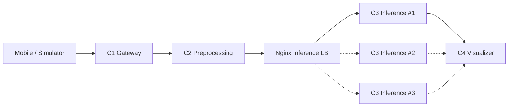

# pocket-smart-factory

> **주머니 속의 스마트 팩토리 — SAM 2 및 모바일 스트리밍 기반 실시간 불량 과자 검출 시스템**

> 🚧 **현재 상태: Repository Skeleton.** 실행 가능한 application 코드는 아직 없다. 각 컨테이너는 `sleep infinity`로만 유지된다.

---

## 1. 프로젝트 소개

스마트폰 카메라(또는 Simulator)로 촬영한 생산 라인 영상을 실시간(목표 30fps)으로 스트리밍하고, **SAM 2**(Segment Anything Model 2) 기반 segmentation/tracking으로 과자 객체를 분할·추적하여 불량(파손, 결손 등)을 검출한다.

4개의 논리 Microservice와 Nginx inference load balancer로 구성되며, **C3 추론 서비스를 Scale-out** 하면서 파이프라인 병목을 측정·분석하는 것이 핵심 목표다.

## 2. 시스템 아키텍처



상세: [`docs/architecture.md`](docs/architecture.md)

## 3. 서비스 설명

| Service | 역할 | 기술 (예정) | 문서 |
|---|---|---|---|
| **C1 Gateway** | 30fps 영상 스트림 수신, `trace_id`/`frame_id`/timestamp 생성 | FastAPI WebSocket | [README](services/c1-gateway/README.md) |
| **C2 Preprocessing** | resize, ROI crop, 과자 후보 bbox → SAM2 prompt | OpenCV | [README](services/c2-preprocessing/README.md) |
| **Nginx Inference LB** | `/infer`를 C3 replica에 round-robin 분배 | Nginx | [nginx.conf](infra/nginx/nginx.conf) |
| **C3 SAM2 Inference** | SAM2 segmentation/tracking, mask 기반 defect 판단 (GPU, scale-out) | PyTorch + CUDA + SAM2 | [README](services/c3-inference/README.md) |
| **C4 Visualizer** | mask/bbox/불량 overlay, FPS·latency·defect·drop 모니터링 | TBD | [README](services/c4-visualizer/README.md) |

## 4. 데이터 흐름

```
Mobile/Simulator ──WS──▶ C1 ──frame-envelope──▶ C2 ──processed-frame──▶ Nginx /infer ──▶ C3[n] ──detection-result──▶ C4
```

| 단계 | Schema | 추가되는 주요 필드 |
|---|---|---|
| C1 → C2 | [`frame-envelope`](shared/schemas/frame-envelope.schema.json) | `source_width/height`, `format`, `gateway_received_at_ms` |
| C2 → C3 | [`processed-frame`](shared/schemas/processed-frame.schema.json) | `preprocess_*_at_ms`, `width/height`, `prompts[]` |
| C3 → C4 | [`detection-result`](shared/schemas/detection-result.schema.json) | `inference_container_id`, `inference_*`, `detections[]` |

공통 필드 `schema_version`, `trace_id`, `session_id`, `frame_id`, `captured_at_ms`는 전 구간에서 그대로 전파된다. 상세: [`docs/api-contract.md`](docs/api-contract.md)

## 5. 디렉터리 구조

```
pocket-smart-factory/
├── README.md
├── .gitignore
├── .env.example
├── docker-compose.yml
├── docs/
│   ├── architecture.md
│   ├── api-contract.md
│   ├── bottleneck-test-plan.md
│   └── team-roles.md
├── infra/
│   └── nginx/              # Inference load balancer
├── services/
│   ├── c1-gateway/
│   ├── c2-preprocessing/
│   ├── c3-inference/       # models/ : checkpoint 로컬 배치 (git 제외)
│   └── c4-visualizer/
├── clients/
│   ├── mobile/
│   └── simulator/
├── shared/
│   └── schemas/            # JSON Schema API Contract
└── benchmark/
    └── results/            # *.csv git 제외
```

## 6. Docker 구성

| Compose service | Profile | Host port | 비고 |
|---|---|---|---|
| `c1-gateway` | (default) | 8000 | |
| `c2-preprocessing` | (default) | — (8001 internal) | |
| `nginx-inference-lb` | (default) | 8080 | `/infer`, `/healthz` |
| `c3-inference-1` | (default) | — (8002 internal) | baseline replica |
| `c3-inference-2` | `scale-out` | — | |
| `c3-inference-3` | `scale-out` | — | |
| `c4-visualizer` | (default) | 8003 | |

- 모든 서비스는 bridge network **`smart-factory-net`** 사용
- 설정은 `.env` (템플릿: `.env.example`) — `cp .env.example .env`
- C3 replica는 동일 이미지(`pocket-smart-factory/c3-inference:dev`)를 공유하며 `INFERENCE_CONTAINER_ID`만 다르다
- GPU reservation은 `docker-compose.yml`에 주석으로 준비되어 있음 (NVIDIA Container Toolkit 필요)
- **모델 weight는 repository에 포함하지 않는다.** `services/c3-inference/models/`에 로컬로 배치하면 `/app/models`로 read-only mount 된다

## 7. Baseline 구성

C3 replica 1개로 실행한다.

```bash
cp .env.example .env
docker compose up -d
```

실행 서비스: `c1-gateway`, `c2-preprocessing`, `nginx-inference-lb`, `c3-inference-1`, `c4-visualizer`

`nginx.conf`의 upstream에는 `c3-inference-1~3`이 모두 선언되어 있지만, `resolve` 옵션(nginx ≥ 1.27.3) 덕분에 2/3이 존재하지 않아도 Nginx는 정상 기동하며 실행 중인 replica로만 요청을 보낸다.

## 8. Scale-out 구성

```bash
# C3 x 3
docker compose --profile scale-out up -d

# C3 x 2 (baseline 실행 후 replica 하나만 추가)
docker compose up -d
docker compose up -d c3-inference-2
```

- Nginx는 Docker DNS(`127.0.0.11`)를 10초 주기로 재조회하므로 replica 추가/제거 시 재시작이 필요 없다
- 요청 분배는 round-robin (기본). 어떤 replica가 처리했는지는 `detection-result.inference_container_id`와 Nginx access log의 `upstream=`로 확인한다
- ⚠️ SAM2 video tracking은 세션 state를 가지므로 round-robin과 충돌할 수 있다 → [`services/c3-inference/README.md`](services/c3-inference/README.md#open-issues)
- ⚠️ 단일 GPU에서 replica를 늘리면 GPU를 공유하므로 처리량이 선형으로 증가하지 않을 수 있다

## 9. 병목 측정 방법

1. `clients/simulator`로 고정 영상을 30fps로 송출 (재현 가능한 부하)
2. 각 단계 timestamp(`gateway_received_at_ms` → `preprocess_*` → `inference_*` → C4 표시 시각)를 `trace_id`/`frame_id` 기준으로 수집
3. C3 x 1 / x 2 / x 3 구성별로 동일 조건 반복 측정
4. Input/Processed FPS, Frame Drop Rate, 단계별 latency P50/P95, GPU utilization/VRAM을 비교
5. Raw 결과는 `benchmark/results/*.csv`(git 제외), 요약은 비교표에 기록

상세 Metric 정의 및 비교표: [`docs/bottleneck-test-plan.md`](docs/bottleneck-test-plan.md)

## 10. 팀 역할

| Member | 담당 |
|---|---|
| Member A | C1 Gateway + Docker Compose + Integration |
| Member B | C2 Preprocessing + Simulator |
| Member C | C3 SAM2 Inference + Nginx Scale-out + Benchmark |
| Member D | C4 Visualizer + Monitoring |

상세: [`docs/team-roles.md`](docs/team-roles.md)

## 11. 개발 TODO

**공통 / 설계**
- [ ] 서비스 간 전송 방식 확정 (HTTP / WebSocket / Queue)
- [ ] 프레임 이미지 전송 방식 확정 (base64 / binary / 참조)
- [ ] SAM2 tracking state vs. round-robin 정책 결정
- [ ] 시계 동기화 및 latency 정의 확정

**C1 Gateway (A)**
- [ ] FastAPI WebSocket 수신, id/timestamp 생성, backpressure 정책
- [ ] compose `command`를 실제 entrypoint로 교체, healthcheck 추가

**C2 Preprocessing / Simulator (B)**
- [ ] resize / ROI crop / 후보 bbox 생성
- [ ] 30fps Simulator 구현

**C3 Inference / Nginx / Benchmark (C)**
- [ ] PyTorch + CUDA base image, SAM2 설치, GPU reservation 활성화
- [ ] SAM2 추론 및 defect 판단, mask 인코딩 확정
- [ ] 분배 정책 비교 (round-robin / least_conn / session hash)
- [ ] 벤치마크 실행 및 결과 기록

**C4 Visualizer (D)**
- [ ] Dashboard 프레임워크 선정, overlay 렌더링
- [ ] FPS / latency / defect / drop 모니터링, CSV export

**Mobile (TBD)**
- [ ] 모바일 송출 방식 결정 (`clients/mobile/README.md`)
