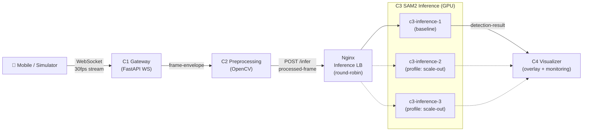
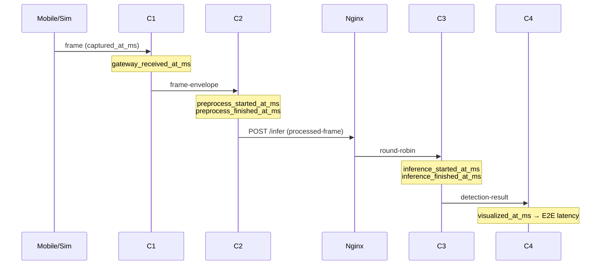

# Architecture

## 전체 구조

점선은 `scale-out` profile 실행 시에만 활성화되는 경로이다.

## 컴포넌트

| Component | Container | Port | 책임 |
|---|---|---|---|
| C1 Gateway | `c1-gateway` | 8000 (host) | 스트림 수신, `trace_id`/`frame_id`/timestamp 부여 |
| C2 Preprocessing | `c2-preprocessing` | 8001 (internal) | resize, ROI crop, 후보 bbox → SAM2 prompt |
| Inference LB | `nginx-inference-lb` | 8080 (host) | `/infer`를 C3 replica에 round-robin 분배 |
| C3 SAM2 Inference | `c3-inference-{1,2,3}` | 8002 (internal) | SAM2 segmentation/tracking, defect 판단 |
| C4 Visualizer | `c4-visualizer` | 8003 (host) | overlay 표시, FPS/latency/defect/drop 모니터링 |

모든 컨테이너는 Docker network `smart-factory-net`에 연결된다.

## Timestamp 흐름 (latency 분해)

## 설계상 미결정 사항 (TODO)
- [ ] 서비스 간 전송 방식: HTTP POST vs. WebSocket vs. 메시지 큐
- [ ] 프레임 이미지 전송 방식: base64 JSON vs. binary vs. 공유 저장소 참조
- [ ] SAM2 tracking state와 round-robin 간 충돌 (session affinity 여부) — `services/c3-inference/README.md` 참고
- [ ] C4의 원본 프레임 수신 경로
- [ ] 컨테이너 간 시계 동기화 (같은 호스트면 문제 적음, 모바일 `captured_at_ms`는 보정 필요)
